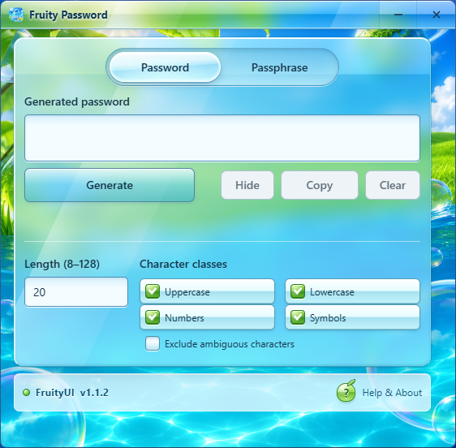

# Fruity Password v1.0.0

An offline desktop password and passphrase generator with **Frutiger Aero** styling.

Fruity Password brings glass controls, leafy greens, and blue water to a familiar
task in the Fruity Suite. Generate a password or passphrase, then copy it when
you’re ready.

<p align="center">
  
</p>

<p align="center">
  <a href="https://github.com/kapsaloco/FruityPassword/releases">Downloads &amp; Releases</a>
</p>

## Features

- Generate passwords from 8 to 128 characters. Choose uppercase, lowercase, numbers,
  and symbols, and optionally exclude ambiguous characters.
- Generate 4–10 word passphrases from the bundled EFF Long Wordlist, with hyphens
  or spaces between words.
- Edit a visible password directly. Generated results include a randomness
  estimate in bits, which clears after a manual edit.
- Show, hide, copy, or clear either tab’s result.

## Usage

1. Select **Password** or **Passphrase** and choose your settings.
2. Select **Generate**, or press **Ctrl+Enter** on Windows or **⌘+Enter** on macOS.
3. Edit the password if needed, then select **Copy**. Select **Clear** to remove
   the result from the active tab.

## Privacy

Fruity Password generates credentials on your device and sends zero data to
servers. Each tab keeps its latest result in memory while the app is open.
Clipboard history, synchronization, and other applications may retain copied text.

The Windows app uses the Microsoft Edge WebView2 runtime.

## Development

Fruity Password uses Tauri 2, Vite, vanilla TypeScript, and FruityUI 1.1.2.

```powershell
npm ci
npm test
npm run tauri dev
```

Run `npm run build` to build the frontend or `npm run tauri build` to package the desktop app.

Run `npx playwright install chromium` once, then `npm run test:ui` to test the built app in Chromium. Set `FRUITY_TEST_BROWSER` to the path of an installed Chrome or Edge executable to use that browser.

## FruityUI

This repo carries FruityUI 1.1.2. For another Fruity app, copy the complete
[`src/styles/fruity/`](src/styles/fruity) directory and follow the
[integration guide](src/styles/fruity/README.md). See the
[FruityUI changelog](src/styles/fruity/CHANGELOG.md) for release history.

Run `npm run build:showcase` and open `dist-showcase/offline/v1.1.2/fruity.html`
to view the interactive showcase. The [showcase guide](showcase/README.md) covers
the demos and earlier releases.

## License

Fruity Password is available under the [MIT License](LICENSE). FruityUI carries
its own [MIT license](src/styles/fruity/LICENSE), and third-party dependencies
retain their respective licenses.

The Electronic Frontier Foundation’s [EFF Long Wordlist](https://www.eff.org/files/2016/07/18/eff_large_wordlist.txt)
is bundled verbatim under [CC BY 4.0](https://creativecommons.org/licenses/by/4.0/).
